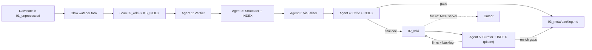

# RAGgamuffin

A local-first knowledge base for a codebase you have to learn: one page per
business concept, pinned to the code by verified anchors, updated by upsert,
validated against the repo, reviewed by a human once a week.

> **Current pipeline (since 2026-10-15):** `ingest.py`, `validate.py`, `kb.json`,
> and the Claude Code skill `/ingest-inbox`. Read `PROJECT.md` for the design and
> `docs/msty-setup.md` to use Msty Studio as the chat front. Everything below this
> box describes the original 2026-06 five-agent design; its prompts in `agents/`
> and the Claw playbook in `claw/` are kept as reference and are no longer the
> path that produces pages.

## Weekly loop

1. While you work, ask any LLM for a summary of what you learned and save it as
   `.md` in `vault/01_unprocessed/`.
2. Thursday, in Claude Code inside this folder: `/ingest-inbox`. It sizes the
   run and asks before spending, reads the concept index, upserts each file into
   `vault/concepts/`, validates pages against the code, and writes
   `vault/03_meta/reviews/<date>.md`.
3. Open the vault in Obsidian, `_views/concepts.base`, "Needs attention first".
   Delete junk with `python3 ingest.py --reject <slug>`; it never comes back.
4. Ask questions in Msty Studio with the `Portal Guide` persona (see docs).

Sources never move: `~/Herd/documentation` stays where it is and the inbox is
archived after ingest. The ledger (`vault/03_meta/ledger.json`) knows what was
processed by content hash, so nothing is scanned twice and an edited source is
re-ingested on its own.

## Portable

`kb.json` is committed and points at this project's vault, sources and code
repo. `kb.local.json` (ignored) holds the machine's Ollama URL and model; copy
`kb.local.example.json` on a new Mac. Another project gets its own `kb.json`
and its own vault. The vault contents are never committed to this repo.

---

# Original design (2026-06), kept for reference


A local-first, multi-agent pipeline that turns raw, messy coding notes into a
pristine, structured Obsidian knowledge base — running entirely on local
models (llama.cpp via Msty / Msty Claw). No data leaves your machine.

> **Full documentation with visuals**: open
> [docs/documentation.html](docs/documentation.html) in a browser — covers the
> pipeline, wiki loop, user flow, Obsidian guide for rookies, Msty setup
> checklist, logging design, and FAQ. For how Msty Claw itself works, open
> [docs/claw-guide.html](docs/claw-guide.html).

## How it works



| Agent | Job | Prompt |
|---|---|---|
| 1 Verifier | Fact-checks prose against the code in the note; flags contradictions with callouts | [agents/agent1-verifier.md](agents/agent1-verifier.md) |
| 2 Structurer | Business logic first, code hidden in `<details>` toggles, English prose, `## Composition` for molecules/organisms (INDEX-aware) | [agents/agent2-structurer.md](agents/agent2-structurer.md) |
| 3 Visualizer | Injects Obsidian-safe Mermaid diagrams, changes nothing else | [agents/agent3-visualizer.md](agents/agent3-visualizer.md) |
| 4 Critic | Final QA gate; repairs mechanical defects, writes the doc, logs enrichment-shaped gaps to the backlog | [agents/agent4-critic.md](agents/agent4-critic.md) |
| 5 Curator | Runs twice: hot-path placer (per new note, adds outbound `[[links]]`) + weekly full-wiki sweep | [agents/agent5-curator.md](agents/agent5-curator.md) |
| 6 Consultant | Interactive ticket triage: paste a ticket, get a KB-grounded plan plus an explicit missing-info list | [agents/agent6-consultant.md](agents/agent6-consultant.md) |
| 8 Sentinel | Weekly git diff check: changelog since last commit, flags stale KB documents | [agents/agent8-sentinel.md](agents/agent8-sentinel.md) |

Agents 1-5 form the per-note hot path (runs on every file drop). Every run
rescans `02_wiki/` into a `KB_INDEX` that Agents 2, 4, and 5 use to place the
new note in the graph (outbound `[[links]]`, Composition suggestions,
enrichment-shaped backlog). Inbound-mesh sweeps across older notes stay in the
weekly `kb-curate` playbook. The Consultant is a chat skill you talk to
directly — in Msty with a Knowledge Stack, or in Cursor via MCP.

## Repo layout

```
agents/         system prompts (source of truth — paste into Msty Skills Studio)
claw/           Msty Claw orchestration guide (bot, playbooks, watcher, security)
docs/           documentation.html (main docs) + claw-guide.html (Claw explained)
vault/          the Obsidian vault (open THIS folder as a vault in Obsidian)
  01_unprocessed/   drop raw notes here (inbox)     (contents NOT committed)
  02_wiki/          the knowledge base — read this  (contents NOT committed)
  03_meta/
    archive/        raw originals after processing  (contents NOT committed)
    backlog.md, changelogs, logs, sentinel-state (templates committed)
  _views/           Obsidian Bases templates + overview note (committed)
  samples/          sample raw notes for smoke-testing the pipeline (committed)
```

## Privacy model: what git sees

The repo is the **pipeline**, not the **knowledge**:

- Committed: prompts, docs, folder structure, the empty backlog template.
- Ignored: all note contents in `01_unprocessed/`, `02_wiki/`, and `03_meta/archive/`, plus
  `.obsidian/` machine state. Your work notes (which may contain company code)
  never end up on a personal remote.

Syncing the actual vault content on the work machine is a separate concern —
use whatever your company approves (an internal git remote for the `vault/`
folder, a synced network drive, or Obsidian Sync with company blessing). Do
NOT just flip the `.gitignore` and push company code to a personal GitHub.

## Setup on a fresh machine (home or work)

1. Clone this repo.
2. Open **the `vault/` folder** as a vault in Obsidian (Open folder as vault).
   Each machine gets its own `.obsidian/` state; that is intentional.
3. Install Msty Claw and your llama.cpp models (Gemma / Qwen).
4. Follow [claw/playbook.md](claw/playbook.md) step by step: providers, bot,
   security, skills, playbook, manual validation, then the watcher.
5. Drop a note into `vault/01_unprocessed/` and watch the assembly line go.

## Usage

- Write raw notes as `.md` files into `vault/01_unprocessed/`. Messy is fine —
  that is the whole point. Include the relevant code snippets in the note;
  Agent 1 can only verify claims against code it can see.
- Keep notes focused: one topic per note. Many small notes beat one epic
  (small local models have small context windows).
- Check `vault/03_meta/backlog.md` periodically and resolve flagged gaps.

## Wiki structure: atoms, molecules, organisms

Every note in `02_wiki/` carries a YAML frontmatter block with three properties:

```yaml
---
type: entity        # entity | process | integration | concept | reference
tier: atom          # atom | molecule | organism
domain: property    # free-form business area, e.g. financing, identity, admin
---
```

**tier** is determined by the zero-prerequisite litmus: *"Can I understand this note without reading any other wiki note first?"*

- `atom` — yes. Defines exactly ONE thing. Most notes are atoms.
- `molecule` — composes 2-5 atoms; ships a `## Composition` section listing them.
- `organism` — a named business feature; composes molecules and atoms; also ships a `## Composition` section.

### Composition, suggestions, and the backlog

Every ingest rescans `02_wiki/` to build a `KB_INDEX`. The Structurer uses it
to fill the `## Composition` section on molecules/organisms:

- Dependencies that already have a wiki page → `[[stem|Name]]` links.
- Dependencies that don't → plain text with a `(suggested)` marker; the
  Critic and Curator then log a backlog entry so the missing page gets
  written.

Backlog entries follow a three-part shape so you know why to read/write
something AND which existing articles it would enrich:

```
- [ ] **<topic to look up>** — <why to look it up> — enriches: `02_wiki/<stem>.md` #<tag>
```

The hot-path Curator only edits the note it just placed. Inbound-mesh sweeps
(adding `[[links]]` from older notes to the new one) happen in the weekly
`kb-curate` playbook.

### Interface A: browsing and maps (no code required)

- **Graph view** (`Cmd/Ctrl+G`): the visual map of your knowledge. Atoms cluster at the leaves; organisms sit at the hubs. Use local graph on any note to see its immediate neighbourhood.
- **Obsidian Bases** (`vault/_views/`): live Table and Card views of your notes sliced by `type`, `tier`, or `domain`. Enable the Bases core plugin under *Settings → Core plugins → Bases*, then open `vault/_views/overview.md` as your dashboard.
  - `_views/atoms.base` — all atoms grouped by domain.
  - `_views/by-tier.base` — the full inventory, grouped atom → molecule → organism.
  - `_views/missing-tier.base` — notes that slipped through without classification.
- **Mermaid diagrams**: every note with `type: process` or `type: integration` gets at least one flow diagram, inserted by Agent 3.

### Interface B: chat and on-the-fly answers

Build a Msty Knowledge Stack from `02_wiki/` and attach Agent 6 (Consultant). See [claw/playbook.md](claw/playbook.md) section 10. The two-axis frontmatter helps the Consultant distinguish "what is X?" (prefer atoms) from "how does X work end-to-end?" (prefer molecules/organisms).

## Future: MCP server for Cursor

Once `02_wiki/` has content, expose it to Cursor as read-only context via
the filesystem MCP server. In Cursor: Settings > MCP, or `.cursor/mcp.json` in
the project where you want the knowledge available:

```json
{
  "mcpServers": {
    "raggamuffin-kb": {
      "command": "npx",
      "args": [
        "-y",
        "@modelcontextprotocol/server-filesystem",
        "/absolute/path/to/RAGgamuffin/vault/02_wiki"
      ]
    }
  }
}
```

Point it at `02_wiki` only — the agent gets the curated knowledge, not
the raw mess or archived originals. Adjust the absolute path per machine.

## Things to know before going all-in

- Small local models WILL occasionally break the output contract (preambles,
  stray code fences). Agent 4 exists precisely to catch this — never skip it.
- Process one file per run. Batch-processing with 4B-class models degrades
  output badly as context fills up.
- Content inside `<details>` toggles is not indexed the same as regular text
  by some Obsidian plugins/search. Acceptable tradeoff for readability, but
  know it is there.
- Test the full chain manually on 2-3 sample notes before enabling the
  watcher task. See step 6 of the Claw guide.
- The prompt files in `agents/` are the source of truth. Edit there, commit,
  re-paste into Skills Studio on each machine — otherwise machines drift.
