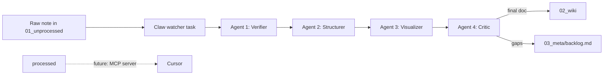

# RAGgamuffin

A local-first, multi-agent pipeline that turns raw, messy coding notes into a
pristine, structured Obsidian knowledge base — running entirely on local
models (llama.cpp via Msty / Msty Claw). No data leaves your machine.

> **Full documentation with visuals**: open
> [docs/documentation.html](docs/documentation.html) in a browser — covers the
> pipeline, wiki loop, user flow, Obsidian guide for rookies, Msty setup
> checklist, logging design, and FAQ. For how Msty Claw itself works, open
> [docs/claw-guide.html](docs/claw-guide.html).

## How it works



| Agent | Job | Prompt |
|---|---|---|
| 1 Verifier | Fact-checks prose against the code in the note; flags contradictions with callouts | [agents/agent1-verifier.md](agents/agent1-verifier.md) |
| 2 Structurer | Business logic first, code hidden in `<details>` toggles, optional Dutch/English protocol, `[[wiki links]]` | [agents/agent2-structurer.md](agents/agent2-structurer.md) |
| 3 Visualizer | Injects Obsidian-safe Mermaid diagrams, changes nothing else | [agents/agent3-visualizer.md](agents/agent3-visualizer.md) |
| 4 Critic | Final QA gate; repairs mechanical defects, writes the doc, logs gaps to the backlog | [agents/agent4-critic.md](agents/agent4-critic.md) |
| 5 Curator | Scheduled wiki gardener: adds missing links, reports missing documents and reader questions | [agents/agent5-curator.md](agents/agent5-curator.md) |
| 6 Consultant | Interactive ticket triage: paste a ticket, get a KB-grounded plan plus an explicit missing-info list | [agents/agent6-consultant.md](agents/agent6-consultant.md) |
| 8 Sentinel | Weekly git diff check: changelog since last commit, flags stale KB documents | [agents/agent8-sentinel.md](agents/agent8-sentinel.md) |

Agents 1-4 form the lean per-note hot path (runs on every file drop). The
Curator and Sentinel run on weekly schedules (separate playbooks, zero per-note
latency). The Consultant is a chat skill you talk to directly — in Msty with a
Knowledge Stack, or in Cursor via MCP.

## Repo layout

```
agents/         system prompts (source of truth — paste into Msty Skills Studio)
claw/           Msty Claw orchestration guide (bot, playbooks, watcher, security)
docs/           documentation.html (main docs) + claw-guide.html (Claw explained)
vault/          the Obsidian vault (open THIS folder as a vault in Obsidian)
  01_unprocessed/   drop raw notes here (inbox)     (contents NOT committed)
  02_wiki/          the knowledge base — read this  (contents NOT committed)
  03_meta/
    archive/        raw originals after processing  (contents NOT committed)
    backlog.md, changelogs, logs, sentinel-state (templates committed)
```

## Privacy model: what git sees

The repo is the **pipeline**, not the **knowledge**:

- Committed: prompts, docs, folder structure, the empty backlog template.
- Ignored: all note contents in `01_unprocessed/`, `02_wiki/`, and `03_meta/archive/`, plus
  `.obsidian/` machine state. Your work notes (which may contain company code)
  never end up on a personal remote.

Syncing the actual vault content on the work machine is a separate concern —
use whatever your company approves (an internal git remote for the `vault/`
folder, a synced network drive, or Obsidian Sync with company blessing). Do
NOT just flip the `.gitignore` and push company code to a personal GitHub.

## Setup on a fresh machine (home or work)

1. Clone this repo.
2. Open **the `vault/` folder** as a vault in Obsidian (Open folder as vault).
   Each machine gets its own `.obsidian/` state; that is intentional.
3. Install Msty Claw and your llama.cpp models (Gemma / Qwen).
4. Follow [claw/playbook.md](claw/playbook.md) step by step: providers, bot,
   security, skills, playbook, manual validation, then the watcher.
5. Drop a note into `vault/01_unprocessed/` and watch the assembly line go.

## Usage

- Write raw notes as `.md` files into `vault/01_unprocessed/`. Messy is fine —
  that is the whole point. Include the relevant code snippets in the note;
  Agent 1 can only verify claims against code it can see.
- Keep notes focused: one topic per note. Many small notes beat one epic
  (small local models have small context windows).
- Check `vault/03_meta/backlog.md` periodically and resolve flagged gaps.

## Future: MCP server for Cursor

Once `02_wiki/` has content, expose it to Cursor as read-only context via
the filesystem MCP server. In Cursor: Settings > MCP, or `.cursor/mcp.json` in
the project where you want the knowledge available:

```json
{
  "mcpServers": {
    "raggamuffin-kb": {
      "command": "npx",
      "args": [
        "-y",
        "@modelcontextprotocol/server-filesystem",
        "/absolute/path/to/RAGgamuffin/vault/02_wiki"
      ]
    }
  }
}
```

Point it at `02_wiki` only — the agent gets the curated knowledge, not
the raw mess or archived originals. Adjust the absolute path per machine.

## Things to know before going all-in

- Small local models WILL occasionally break the output contract (preambles,
  stray code fences). Agent 4 exists precisely to catch this — never skip it.
- Process one file per run. Batch-processing with 4B-class models degrades
  output badly as context fills up.
- Content inside `<details>` toggles is not indexed the same as regular text
  by some Obsidian plugins/search. Acceptable tradeoff for readability, but
  know it is there.
- Test the full chain manually on 2-3 sample notes before enabling the
  watcher task. See step 6 of the Claw guide.
- The prompt files in `agents/` are the source of truth. Edit there, commit,
  re-paste into Skills Studio on each machine — otherwise machines drift.
