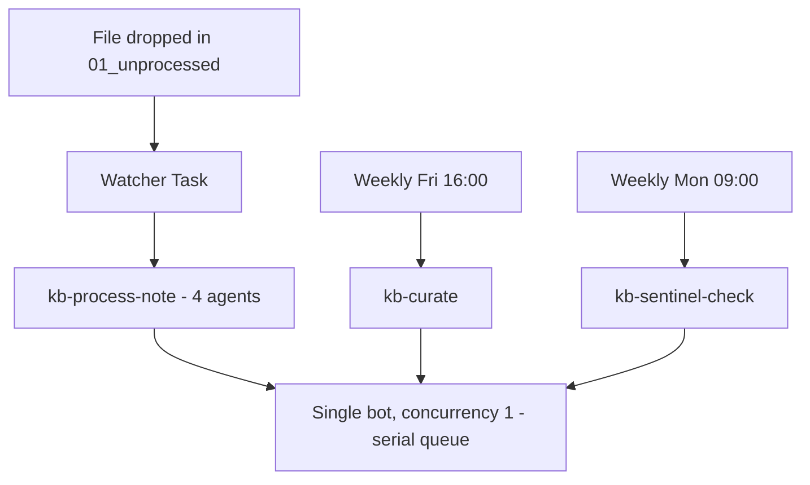

# Msty Claw Orchestration Guide

Step-by-step configuration to chain the agents into an automated pipeline.

Two tiers (see the Task wiring summary at the end):
- HOT PATH (per note, runs instantly on file drop): Agents 1-4 —
  Verifier -> Structurer -> Visualizer -> Critic.
- OUT-OF-BAND (no per-note latency): Agent 5 (Curator, weekly, section 9),
  Agent 6 (Consultant, interactive chat, section 10), Agent 8 (Sentinel,
  weekly, section 11).

Follow the steps in order; do not enable the watcher (step 7) until manual
runs (step 6) produce correct output.

Replace `<REPO>` below with the absolute path to this repo on the current
machine (e.g. `/Users/you/Code/RAGgamuffin` at home, `C:\Code\RAGgamuffin` at work).

Replace `<CODE_REPO>` with the absolute path to the application codebase you
document at work (e.g. `/Users/you/Code/my-laravel-app`). The Sentinel reads
this repo; the KB pipeline does not write to it.

---

## 1. Providers — local models

Settings > Providers:

- Confirm your llama.cpp models (Gemma / Qwen) are listed and selectable.
- Suggested assignment:
  - Agent 1 (Verifier): your strongest reasoning model (e.g. Qwen) — fact-checking is the hardest job.
  - Agents 2, 3, 4: any instruction-following model; formatting fidelity matters more than raw intelligence.
  - Agent 6 (Consultant): strongest model you have; it reasons and plans.
  - Agent 8 (Sentinel): reasoning model; reads commit messages and matches to KB titles.
- Per-skill model settings (set when creating each skill, step 4):

| Agent | temperature | top_p | notes |
|---|---|---|---|
| 1 Verifier | 0.3 | 0.9 | needs slight reasoning latitude |
| 2 Structurer | 0.1–0.2 | 0.9 | deterministic formatting; owns language rules |
| 3 Visualizer | 0.1 | 0.9 | mermaid syntax breaks easily at higher temps |
| 4 Critic | 0.1 | 0.9 | mechanical validation |
| 5 Curator | 0.2 | 0.9 | link matching needs a little judgment |
| 6 Consultant | 0.4 | 0.9 | plans and reasons; strongest model you have |
| 8 Sentinel | 0.2 | 0.9 | commit-to-KB matching |

Set repeat_penalty ~1.1 if available. Give each agent the largest context window
your hardware allows — a note plus a structured rewrite can be long.

## 2. Bot

Settings > Bots > Create:

- **Workspace**: Project folder → `<REPO>/vault`
- **Runtime**: Host (fast local iteration; switch to Container later if you want isolation)
- **Routing**: Local only — no channels, no remote delivery
- **Permissions**: minimum needed — file read/write inside the workspace only
- One bot is enough; the pipeline stages are skills, not separate bots ("one purpose per bot" still holds: this bot's one purpose is the KB pipeline).

## 3. Security baseline (do this BEFORE first run)

Settings > Security:

- **Allowed Folders**:
  - `<REPO>/vault` — read/write (wiki output, archive, logs, backlog)
  - `<CODE_REPO>` — **read-only** (Sentinel git reads only; add only when you enable section 11)
  Do NOT allow your home directory.
- **Blocked Patterns**: keep defaults (`.ssh`, `.env`, `credentials`, etc.).
- **Network Guard**: `Strict` — this pipeline never needs the internet. On the work computer this is non-negotiable.
- **Approvals**: keep ON until the pipeline has run cleanly several times, then relax for file writes inside the vault if the prompts get tedious.

## 4. Skills (Skills Studio)

Settings > Agent Mode > Skills Studio:

1. Create a folder `kb-pipeline`.
2. Create seven skills inside it: `kb-verifier`, `kb-structurer`, `kb-visualizer`, `kb-critic`, `kb-curator`, `kb-consultant`, `kb-sentinel`.
3. For each, paste the contents of the matching file in `<REPO>/agents/` (everything below the `---` line) into the skill instructions.
4. System prompt mode: **Replace** — the default assistant prompt would dilute the output contracts.
5. Keep skill IDs stable; the playbooks reference them by name.

Update protocol: the repo files in `agents/` are the source of truth. When you
improve a prompt, edit the repo file first, commit, then re-paste into Skills
Studio on each machine.

## 5. Playbook

Create a playbook `kb-process-note` (custom authoring, or teach-mode from a
successful manual chat run). The ordered steps:

1. **Input**: list `01_unprocessed/`, pick the OLDEST `.md` file. If the folder is empty, stop. Process exactly ONE file per run — never batch (small models + long contexts = garbage output).
2. **Agent 1**: run skill `kb-verifier` with the raw file content as input. Capture output.
3. **Agent 2**: run skill `kb-structurer` with Agent 1's output as input. Capture output.
4. **Agent 3**: run skill `kb-visualizer` with Agent 2's output as input. Capture output.
5. **Agent 4**: run skill `kb-critic` with Agent 3's output as input.
6. **Write results**:
   - Split Agent 4's output on the line `=== BACKLOG ===`.
   - Everything ABOVE the marker → write to `02_wiki/<original-filename>.md` (overwrite if it exists).
   - Everything BELOW the marker (if present) → append under the `## Open` heading in `03_meta/backlog.md`.
7. **Log the run**: append a run entry to `03_meta/logs/<YYYY-MM-DD>.md`
   (create the folder/file if missing). Format in section 8 below.
8. **Cleanup**: move the source file out of `01_unprocessed/` into
   `03_meta/archive/` (do not delete — the originals are needed for
   reprocessing, and archiving prevents the watcher from re-triggering).

Success criteria to state in the playbook: `02_wiki/<file>.md` exists,
starts with `#`, contains `## Samenvatting`, contains at least one
` ```mermaid ` block, and `01_unprocessed/` no longer contains the source file.

## 6. Validate manually first

Per Claw's own rollout guidance:

1. Drop ONE sample note into `01_unprocessed/`.
2. Run the playbook manually from the playbook screen.
3. Open the result in Obsidian and check: toggles collapse/expand, mermaid renders, links resolve, Dutch/English split is right.
4. Repeat with 2-3 notes of different messiness. Use Auto Refine suggestions only when they improve determinism.

## 7. Task — folder watcher (automation)

Only after step 6 is reliable. Settings/Tasks:

- Create a watcher task on `<REPO>/vault/01_unprocessed/` that triggers the `kb-process-note` playbook when a new file appears.
- Since the playbook processes one file per run, a burst of dropped files drains gradually — that is fine and intentional.
- Alternative if watchers misbehave: a scheduled task every 15 minutes that runs the playbook (it exits immediately when the folder is empty).

## 8. Logging format

Principle: **log metadata, never content**. Logs prove the system worked and
show what ran — they must not duplicate note content (which may be sensitive)
into yet another file.

- One file per day: `03_meta/logs/2026-06-11.md`. Append-only; never edit old entries.
- One short block per run, written by the playbook (step 7 above):

```markdown
## 14:32 — stock-sync-debounce.md
- result: success
- output: 02_wiki/stock-sync-debounce.md
- agents: verifier ok (2 flags) | structurer ok | visualizer ok (2 diagrams) | critic repaired 1 defect
- backlog: +2 entries
- duration: ~4 min
- source: archived
```

- On failure, the entry becomes verbose: `result: FAILED at visualizer`,
  what the symptom was, and what to do (e.g. "mermaid parse error — re-run
  Agent 3 manually"). Quiet on success, loud on failure.
- Calibration:
  - Too much: full agent inputs/outputs, prompts, note content, token traces.
    Claw's activity view already holds run details for forensics.
  - Right: timestamp, filename, per-agent ok/repaired/failed, counts (flags,
    diagrams, backlog delta), duration.
  - Too little: "ran 3 files today" — useless when something silently breaks.
- Logs live in `03_meta/logs/`, which is gitignored — local only. Delete logs
  older than ~3 months whenever you notice them; nothing depends on them.

## 9. Curator playbook (wiki gardening)

The Curator turns a pile of documents into an interlinked wiki and surfaces
missing knowledge. It is a SEPARATE playbook, `kb-curate`, that audits ONE
wiki document per run. Don't run it until `02_wiki/` has at least
a handful of documents — there is nothing to interlink before that.

Ordered steps:

1. **Pick a document**: from `02_wiki/`, choose the least-recently
   audited document. Simplest tracking: keep a plain list of audited
   filenames in `03_meta/curator-state.md`; pick the first document NOT on
   the list; when the list contains every document, clear it and start over.
   (A random pick also works and needs no state — acceptable start.)
2. **Build the INDEX**: list all `.md` filenames in `02_wiki/` (titles
   only, no content).
3. **Agent 5**: run skill `kb-curator` with two labeled inputs: the INDEX
   list, and the full document content.
4. **Write results**: split output on `=== BACKLOG ===` exactly like the main
   pipeline. Document above the marker → overwrite the file in
   `02_wiki/`. Entries below → append under `## Open` in
   `03_meta/backlog.md`.
5. **Log the run** in the daily log: `result`, `links added`, `backlog: +N`.

Scheduling: a weekly scheduled task is plenty (e.g. Friday afternoon, one run
per existing document or capped at 5 runs). You can also run it on demand
against a specific document — useful right after processing a batch of
related notes.

Directed research: to have the Curator study a document YOU choose (one of
your own, or external documentation you dropped into the vault as a note),
run `kb-curate` manually and point step 1 at that file. The output is the
same: links added, missing documents and open questions land on the backlog —
which becomes your reading/writing TODO list.

## 10. Consultant skill (ticket triage)

`kb-consultant` is NOT a playbook — it is an interactive skill you chat with.

Usage in Msty:

1. Build a Knowledge Stack from `<REPO>/vault/02_wiki/` (Msty's RAG
   feature) and attach it to the consultant chat/persona. Re-sync the stack
   periodically as documents accumulate. Without a stack, paste the 1-3
   relevant documents into the chat manually.
2. Open a chat with the `kb-consultant` skill, paste the ticket/task.
3. It answers in a fixed format: what it understands → proposed approach
   (citing `[[documents]]`) → assumptions → missing information.
4. If its answer ends with `=== BACKLOG ===` entries (`#ticket-gap`), copy
   them into `03_meta/backlog.md` under `## Open`. Those are knowledge base
   gaps that a real ticket exposed — the highest-value backlog entries you
   can get.

Usage in Cursor (the MCP route): with the filesystem MCP server pointed at
`02_wiki/` (see README), paste a ticket into Cursor chat and instruct:
"Consult the raggamuffin-kb knowledge base before answering; list missing
information explicitly." Same effect, inside your IDE, with Cursor's models.

## 11. Sentinel playbook (weekly code diff check)

The Sentinel keeps the knowledge base honest against a moving codebase. It
compares the git history of `<CODE_REPO>` since the last check, writes a
changelog, and flags KB documents that may be stale.

**One-time setup:**

1. Copy `03_meta/sentinel-state.template.md` → `03_meta/sentinel-state.md`.
2. Set `code_repo` to `<CODE_REPO>` and `branch` to `main` or `master`.
3. Add `<CODE_REPO>` to Allowed Folders as **read-only** (section 3).
4. Leave `last_commit` empty for the first run — the playbook records HEAD.

Create playbook `kb-sentinel-check`:

1. **Read state** from `03_meta/sentinel-state.md` (`last_commit`, `code_repo`, `branch`).
2. **Git metadata** (via Claw shell in `<CODE_REPO>`, read-only):
   - If `last_commit` is empty: `git rev-parse HEAD` and `git log -20 --oneline`.
   - Else: `git log <last_commit>..HEAD --oneline` and `git diff --stat <last_commit>..HEAD`.
   - If no new commits: write a one-line note to today's log and stop.
3. **Build KB_INDEX**: list all `.md` filenames in `02_wiki/`.
4. **Agent 8**: run skill `kb-sentinel` with four labeled inputs: STATE,
   COMMITS, DIFF_SUMMARY, KB_INDEX.
5. **Write results** — split Sentinel output on markers:
   - Changelog (above `=== BACKLOG ===`) → `03_meta/changelogs/<YYYY-MM-DD>.md`
   - Backlog entries (between `=== BACKLOG ===` and `=== STATE ===`) → append under `## Open` in `03_meta/backlog.md`
   - State block (after `=== STATE ===`) → overwrite `03_meta/sentinel-state.md`
6. **Log**: `sentinel check: N commits, M stale docs flagged`.

Scheduling: weekly (e.g. Monday morning). Run manually after a big release.

**Your workflow when `#stale-doc` appears:** find the archived raw note in
`03_meta/archive/`, update it with what changed, copy back to
`01_unprocessed/` — the pipeline re-processes and overwrites the wiki doc.

## Reprocessing (nudging) a note

The pipeline touches each file exactly once: process → archive. It never
re-analyzes on its own. To re-analyze deliberately:

1. Edit the archived raw note in `03_meta/archive/` (add the new info there —
   raw notes in `03_meta/archive/` are the edit source; wiki docs get overwritten).
2. Copy it back into `01_unprocessed/`.
3. The watcher picks it up; the new output OVERWRITES the existing file in
   `02_wiki/` (same filename), so links from other notes keep working.

To merge topics: combine the raw notes into one file yourself, drop it in the
inbox, and delete the superseded documents from `02_wiki/`.

## Task wiring summary (hot path vs. weekly crew)

The whole point of the two-tier design: the watcher triggers ONLY the hot path.
The out-of-band crew runs on the clock and never binds to the inbox. They cannot
collide by construction, because they are separate Tasks pointing at separate
Playbooks.

| Task | Type | Trigger | Runs playbook | Touches inbox? |
|---|---|---|---|---|
| Ingest | Watcher | new `*.md` in `01_unprocessed/` | `kb-process-note` | yes (drains it) |
| Wiki audit | Scheduled | weekly, e.g. Fri 16:00 | `kb-curate` | no |
| Code check | Scheduled | weekly, e.g. Mon 09:00 | `kb-sentinel-check` | no |

Settings to get right:

- **Watcher (hot path):**
  - Watch path: `<REPO>/vault/01_unprocessed/`, pattern `*.md`.
  - Debounce / settle delay: ~5-10s so a half-written file isn't grabbed mid-save.
  - Triggers `kb-process-note` ONLY. Do not point it at any other playbook.
- **Scheduled (out-of-band):** plain cron-style schedules. They are NOT watchers
  and must NOT watch `01_unprocessed/`. Run them off-hours so a weekend audit
  never competes with a live drop.
- **One bot, serial execution:** keep all three Tasks on the SAME bot and set bot
  concurrency to 1. Claw then queues runs instead of running them in parallel —
  so even if a weekly job and a file drop coincide, one waits for the other.
  This is the simplest collision-proofing; no locking logic needed.
- **Fallback if the watcher is flaky:** replace the watcher with a frequent
  scheduled poll (every 5 min) that runs `kb-process-note`; it exits instantly
  when the inbox is empty. Slightly less "instant", far more robust.



## Failure modes to expect

- **Agent output wrapped in a code fence or preceded by chatter**: Agent 4 strips this, but if a file in `02_wiki/` ever starts with anything but `#`, the Critic missed it — re-run that file.
- **Broken mermaid**: open the note in Obsidian; the mermaid block shows a parse error inline. Fix by hand or re-run Agent 3 on the document in a normal chat.
- **Context overflow on long notes**: split the raw note into two smaller notes. Prefer many small notes over one epic.
- **Model swaps**: after changing which model backs a skill, redo step 6 from scratch. Different models break contracts in different ways.
