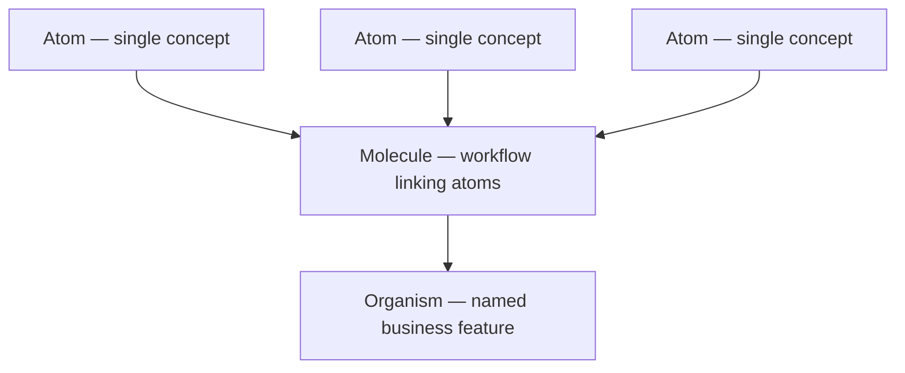

# Knowledge Base Overview

> **Interface A — the map.** This note is the starting point for browsing the wiki.
> Use the **Graph view** (left sidebar → graph icon, or `Ctrl/Cmd+G`) to see connections.
> The live tables below are powered by Obsidian Bases — enable it under
> Settings → Core plugins → Bases if the tables are not rendering.

---

## Atoms (the foundation)

All notes tagged `tier: atom` — the standalone, zero-prerequisite building blocks.
Grouped by domain.

![[atoms.base#Atoms by domain]]

---

## Full inventory by tier

Every wiki note, grouped by atom → molecule → organism.
Notes missing a `tier` classification appear in the **Unclassified** view.

![[by-tier.base#All wiki notes by tier]]

---

## Needs classification

Wiki notes with no `type` or `tier` in their frontmatter.
Empty table means the pipeline is running cleanly.

![[missing-tier.base#Notes missing classification]]

---

## How the tiers compose

---

## Weekly changelogs (Sentinel)

Each weekly Sentinel run writes a changelog to `03_meta/changelogs/`. Use this
to review "what changed in the codebase this week" before a planning session.

![[changelogs.base#Recent changelogs]]

---

## Navigation tips

- **Graph view** (global): the visual map. Atoms cluster at the leaves; organisms sit at the hubs. Use node size by links to spot the most-connected concepts.
- **Local graph** (open a note → `...` menu → Open local graph): shows one note's neighbourhood — its atoms, molecules, or organisms.
- **Mermaid diagrams**: every wiki note with a `process` or `integration` type has at least one flow diagram generated by Agent 3. They show up inline in the note.
- **Backlog**: `vault/03_meta/backlog.md` — open this to see what the pipeline has flagged for your attention.
